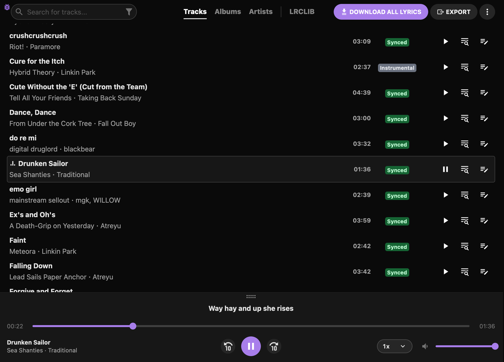
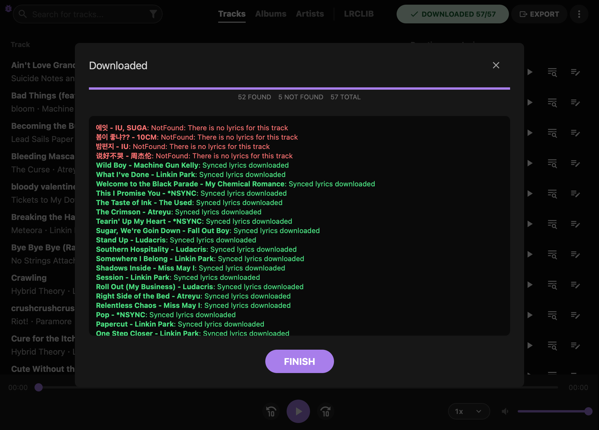
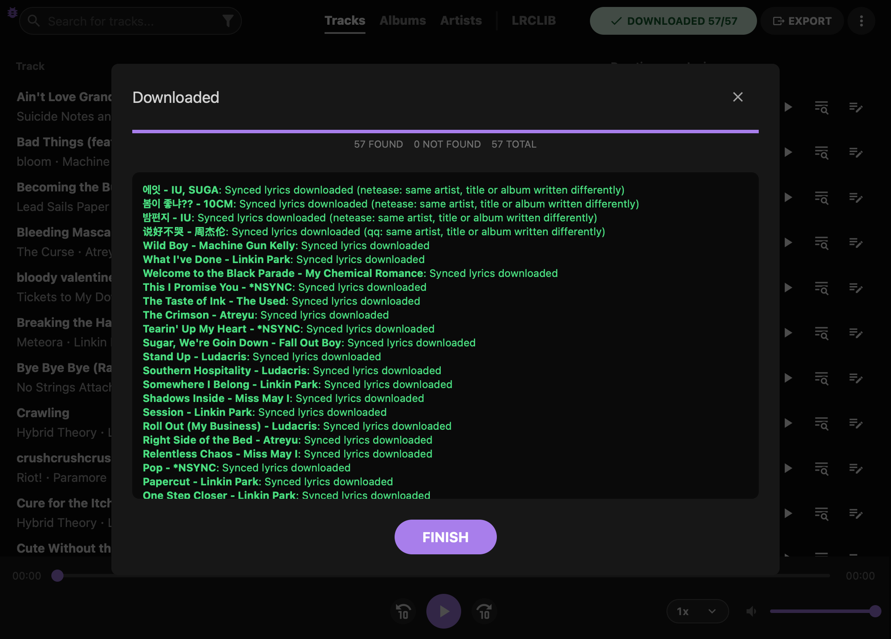
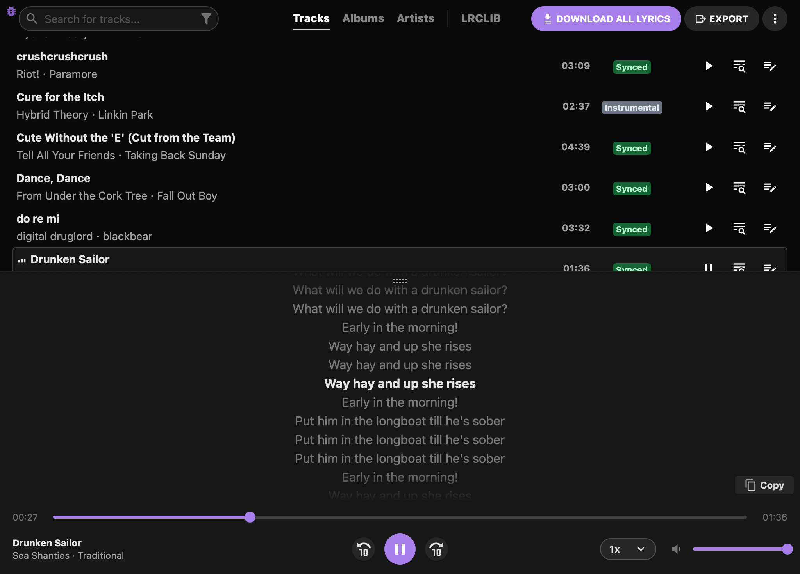
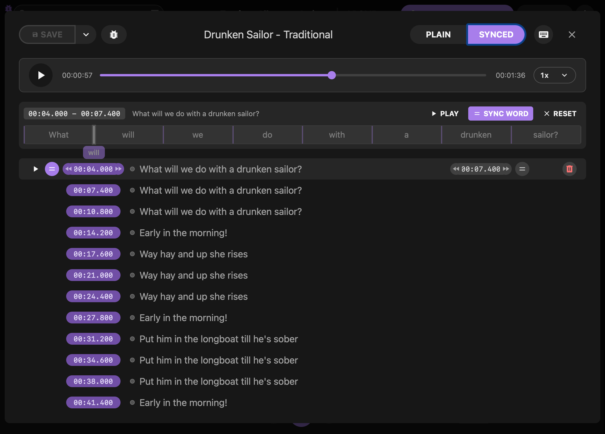
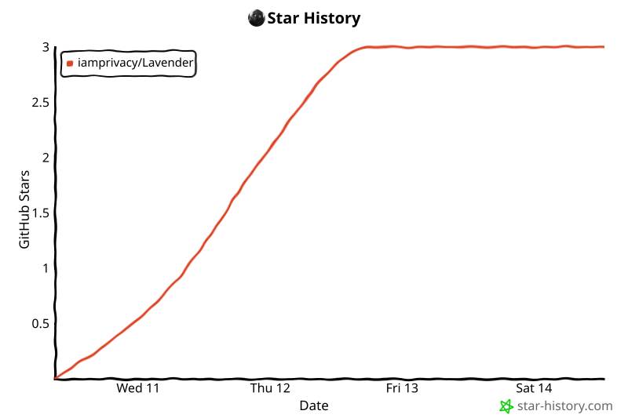

#  Lavender

Lavender downloads synced lyrics (`.lrc`) for your whole music library in one
go. It started as a fork of [LRCGET](https://github.com/tranxuanthang/lrcget)
and does everything LRCGET does, plus a lot more:

- **Look up lyrics offline** from your own copy of the
  [LRCLIB database](https://lrclib.net/db-dumps), instead of sending one web
  request per track.
- **Find more lyrics.** With the local database, a careful matcher catches
  tracks that LRCLIB's exact lookup misses because of small tag differences.
  Optional extra sources fill in what LRCLIB doesn't have at all.
- **Get better lyrics.** When a song has several uploads in the database,
  Lavender picks the best one. It can also upgrade the lyrics you already
  have, from plain to synced and from synced to word-synced.
- **Big libraries welcome.** You can pause downloads, and they survive a
  restart or a dropped connection. With the local database, repeat runs skip
  tracks that were already checked.

It's free and open source (MIT), and it runs on Windows, macOS and Linux.

> [!IMPORTANT]
> Like LRCGET, Lavender keeps downloaded lyrics in its own library first. Other
> music players only see them once they're exported as `.lrc` or `.txt` files
> next to your music. See [Saving lyrics next to your music](#saving-lyrics-next-to-your-music).

## Screenshots



<details>
<summary>More screenshots</summary>

A mass download using LRCLIB alone, as in LRCGET, finds 52 of 57 tracks. The
five misses are songs LRCLIB has no lyrics for:



With NetEase Cloud Music and QQ Music turned on, the same download finds all
57:







</details>

## Lavender vs LRCGET

| | LRCGET | Lavender |
|---|---|---|
| Lyrics from online LRCLIB | ✅ | ✅ (works exactly the same) |
| Lyrics from a local LRCLIB database, offline | | ✅ |
| Download and update that database in the app | | ✅ (parallel, resumable) |
| Matches tracks with messy tags (feat., remaster, several artists...) | | ✅ * |
| Picks the best of several uploads for a song | | ✅ * |
| Upgrade lyrics you already have | | ✅ * |
| Extra sources: AMLL, Apple Music, NetEase, QQ Music | | ✅ (optional, off by default) |
| Word-synced lyrics from LRCLIB: badges, per-word highlighting, editor | ✅ | ✅ |
| Word-synced lyrics from the extra sources, word timestamps in `.lrc` export | | ✅ |
| Prefers uncensored lyrics for explicit songs | | ✅ ** |
| Pause, resume and survive a restart mid-download | | ✅ |
| Skip tracks already checked on the next run | | ✅ * |
| Player, editor, publishing to LRCLIB, My LRCLIB | ✅ | ✅ |
| Export `.lrc` / `.txt`, embed in MP3 and FLAC | ✅ | ✅ |

\* With the local database. \*\* With the local database and the extra
sources; online LRCLIB answers are used as they come.

Lavender has its own app ID, settings and library, so you can keep both apps
installed side by side.

## What Lavender adds

### A local LRCLIB database

Point Lavender at a copy of the LRCLIB database dump and every lookup (mass
downloads, Search Lyrics, My LRCLIB) runs against your own disk.

- The basic lookup follows the LRCLIB server's own rules, so on its own it
  finds what lrclib.net would have found when the dump was made. The matching
  below goes further.
- Tracks the local database can't answer can go to online LRCLIB instead (on
  by default).
- If the drive with the database goes missing, Lavender tells you once, uses
  online LRCLIB in the meantime (when that fallback is on) and picks the
  database up again when it's back.
- The database is opened read-only, so it can live on an external drive.
- **Check for updates** finds the latest dump, and Lavender downloads it over
  up to 8 connections. You can stop and resume the download later, even
  after closing the app. Lavender then unpacks it, checks it, and only then switches over from your
  current database. It checks free disk space before it starts.

### Better matching

These work with the local database. The extra sources are held to the same
title, length and artist rules.

- **Tolerant matching** retries a miss while allowing for common tag
  differences: several artists joined with commas or "&", "(feat. ...)" on one
  side only, version tags like "(Radio Edit)" or "[2011 Remaster]", explicit
  badges, or the same recording filed under another album. It never guesses:
  title, length and artist must still line up, and the download log says how
  each tolerant match was made so you can spot-check it.
- **The best of several uploads.** Many songs have more than one synced
  upload. Lavender ranks them by artist, album, synced over plain, and then by
  the lyrics themselves: broken timing, lyrics that stop early or a stray
  credits line count against an upload, and timing that most uploads agree on
  counts for it (a copy uploaded many times counts once). A copy timed
  unevenly, with lines that run ahead of the singing and fall behind again,
  gives way to a cleaner copy of the same recording even when that one is
  filed under another album. Search Lyrics shows this order and marks the
  "Best match".
- **The right performance.** A studio track gets the studio lyrics, not a live
  or acoustic take's, and a track tagged "(Live)" gets the live take's when the
  database has it.
- **Instrumentals stay instrumental.** A track titled "(Instrumental)" is marked
  instrumental instead of getting someone's wrong upload.
- **Uncensored by default.** When a song exists as both the explicit and the
  clean version, you get the uncensored lyrics unless the file's title or
  album says Clean. A setting lets you always pick one or the other. This
  covers the extra sources too.

### Upgrade the lyrics you already have

With the local database, **Upgrade to the best match** is an extra choice in
the download popup. It goes through your library and:

- finds lyrics for tracks that have none;
- replaces plain lyrics with synced ones when it can find them (locally, then
  online and from the extra sources you turned on);
- replaces synced lyrics with word-synced ones or a clearly better upload, but
  only when your current lyrics came from the database;
- replaces lyrics with masked words ("b\*\*\*h") when it finds an uncensored
  text, whoever wrote them.

Synced lyrics you edited yourself or got elsewhere are kept, and so are
word-synced ones, unless they mask words and the Lyrics edition setting wants
them uncensored. The download log says why each track was kept.

### Extra lyrics sources (optional)

When LRCLIB has nothing, Lavender can ask the **AMLL TTML database**, **Apple
Music**, **NetEase Cloud Music** and **QQ Music**, in that order. They all work
in online mode too.

- All of them are **off by default**. When you turn one on, it gets the title
  and artist of each track LRCLIB couldn't answer, and nothing else. The AMLL
  database is searched through NetEase and QQ Music, so turning it on sends
  those two the same details.
- The AMLL database, Apple Music and sometimes NetEase have **word-synced**
  lyrics. The player highlights each word as it's sung, and `.lrc` export can
  include the word timestamps (enhanced LRC) if you want it to. Search Lyrics
  marks word-synced results with a "Word Synced" badge.
- Apple Music needs your own subscription. You sign in with Apple in a private
  window inside Lavender, and Lavender keeps only the sign-in token. That API
  is unofficial and using it is against Apple Music's terms, so it's your call.
- These services' APIs are unofficial and may stop working at any time. See
  [THIRD_PARTY_NOTICES.md](THIRD_PARTY_NOTICES.md) for exactly what is sent
  where.

### Downloads that hold up

- **Pause and resume** a mass download. If the app is closed or crashes, the
  run comes back as "Download interrupted" and picks up where it stopped.
- **Dropped connection?** Lavender waits and tries the same track again instead
  of marking the rest of the library as not found.
- **No waiting with the local database.** Online mass downloads keep
  LRCGET's pace of about half a second between tracks; local lookups skip
  that pause.
- **Retry not found** queues the misses of a finished run again.
- **Skip what's already checked.** With the local database, Lavender
  remembers which tracks the current database couldn't answer and leaves them
  out next time. A track is checked again after you retag it, install a newer
  dump or turn on more options, and online misses are retried after 14 days. You can clear this memory in
  Settings at any time.

### Everything else

- With the lyrics source set to Online LRCLIB and the extra sources off (the
  defaults), lookups work exactly as in LRCGET, including its pace and its
  waits when LRCLIB asks to slow down. Publishing and flagging always go to
  online LRCLIB.
- An optional update check (off until you turn it on) that installs a new
  release only after its signed checksums match. Every release also ships a
  signed `SHA256SUMS` file.
- Its own lavender look and icon, so the two apps are easy to tell apart.

## Download

Get the latest version from the
[Releases page](https://github.com/iamprivacy/Lavender/releases).

| Platform | File |
|----------|------|
| Windows (x64) | `*-setup.exe` (recommended) or `*.msi` |
| Linux (x86_64) | `*.deb` (Ubuntu 24.04+, Mint 22+), `*.rpm` (Fedora, openSUSE), `*.AppImage` or `*.flatpak` |
| macOS | `*_aarch64.dmg` (Apple Silicon) or `*_x64.dmg` (Intel) |

You can ignore the other files on a release (`.sig`, `.app.tar.gz`,
`latest.json`); they're for the in-app update.

On a Mac you can install with [Homebrew](https://brew.sh) instead; it picks
the Apple Silicon or Intel build for you:

```shell
brew tap iamprivacy/lavender
brew install --cask iamprivacy/lavender/lavender
```

Update with `brew upgrade --cask lavender`, or from **About** in the app.

To install the Flatpak bundle:

```shell
flatpak install --user Lavender*.flatpak
```

The builds aren't code signed yet, so your system may warn you the first time:

- **Windows:** click **More info**, then **Run anyway**.
- **macOS:** open the app once, then click **Open Anyway** in System Settings >
  Privacy & Security.

The release notes list every file's hash and how to check a download.

## Saving lyrics next to your music

Lavender saves lyrics in its own library first. The built-in player, the
editor and Upgrade all work from there, but other players need files next to
the music. To write them:

- **While downloading:** tick **Automatically export lyrics** in the popup that
  **Download all lyrics** opens. Lavender remembers the choice.
- **Later:** click **Export** in the header.

Tick both **Synced lyrics (.lrc)** and **Plain lyrics (.txt)**. Each track then
gets one file: `.lrc` if it has synced lyrics, `.txt` if it only has plain
ones. Careful: ticking only `.txt` replaces existing `.lrc` files with plain
text.

Lyric files already next to your music are read in when Lavender scans your
folders.

## Using the local database

1. Open **Settings** from the ⋮ menu at the top right and set **Lyrics
   source** to **Local database**.
2. Click **Check for updates**, choose where to download the archive and where
   to keep the database, and press **Download the database**. Already have a
   dump? Click **Browse** and pick the `.sqlite3` / `.db` file, or the `.gz`
   archive to unpack it in the app.
3. Save, then download lyrics as usual.

To update later, click **Check for updates**, then **Update the database**.

**Mind the disk space.** The archive is about 48 GB, and Lavender estimates
the unpacked database at around 120 GB. During an update you need room for both, since your current
database stays in use until the new one is ready. Tick **Delete the archive
after decompressing** and **Delete the old database after updating** to get
that space back afterwards.

A fast internal drive gives the quickest lookups, but an external one works
fine.

## Troubleshooting

**Lyrics show in Lavender but not in other players.**
They haven't been exported yet. See
[Saving lyrics next to your music](#saving-lyrics-next-to-your-music).

**No audio on Linux.**
Install `pipewire-alsa`, for example `sudo apt install pipewire-alsa` on
Ubuntu or Debian.

**The app doesn't open on Windows.**
Lavender needs Microsoft WebView2. If you're on Windows 10 LTSC or removed
Edge with a script, reinstalling Edge or the WebView2 runtime usually fixes
it.

**Invisible scrollbar on KDE Plasma.**
In System Settings > Appearance > Global Theme > Application Style >
Configure GNOME/GTK Application Style..., switch from Breeze to something else
(Adwaita, for example).

**"The local LRCLIB database has no search index".**
Some dumps ship without one. Mass downloads still work and title searches use
exact matching; keyword searches go to online LRCLIB if the online fallback is
on.

**Coming from LRC-local-GET?**
That was Lavender's old name. Your settings, library and database setting
carry over, but the two show up as separate apps. If you uninstall
LRC-local-GET on Windows, leave "Delete the application data" unticked, since
Lavender reads from the same place.

## Building from source

Lavender is a [Tauri](https://tauri.app) v2 app: Rust in `src-tauri/`, Vue 3
in `src/`. Install the
[Tauri prerequisites](https://v2.tauri.app/start/prerequisites/) for your
system (Rust 1.90 or newer and a current Node.js LTS), then:

```shell
git clone https://github.com/iamprivacy/Lavender.git
cd Lavender
npm install
npm run tauri dev      # development window
npm run tauri build    # installers, in src-tauri/target/release/bundle/
```

Run the checks:

```shell
npm run lint
npm test
npm run build            # cargo needs the built frontend in dist/
cd src-tauri && cargo test
```

The tests never download the real dump; they build a small database with the
server's real schema. `python3 tools/build_fixture_db.py <folder>` writes one
(plus a `.gz` copy) for trying the local database in a dev build.

Contributors: [PLAN.md](PLAN.md) explains the design,
[FORK_CHANGES.md](FORK_CHANGES.md) lists every change to a file that also
exists in LRCGET (so merges from upstream stay easy), and
[src-tauri/ARCHITECTURE.md](src-tauri/ARCHITECTURE.md) and
[src/ARCHITECTURE.md](src/ARCHITECTURE.md) describe the backend and frontend.
[CHANGELOG.md](CHANGELOG.md) lists what changed in each release.

---

## Star History

<!-- star-history:start -->
<picture>
  <source media="(prefers-color-scheme: dark)" srcset="assets/star-history/star-history-dark.svg">
  
</picture>
<!-- star-history:end -->

---

## Acknowledgements

Lavender wouldn't exist without **tranxuanthang**, who created
[LRCGET](https://github.com/tranxuanthang/lrcget) and
[LRCLIB](https://lrclib.net). LRCGET is the app Lavender is built on, and
LRCLIB is the open lyrics library behind its lookups, freely shared as a
database dump. Thank you for building both and keeping them open. If Lavender
is useful to you, please consider
[sponsoring tranxuanthang](https://github.com/sponsors/tranxuanthang) and
contributing lyrics to LRCLIB.

LRCGET is MIT licensed, and so is the LRCLIB server code that Lavender's local
lookup is ported from. See [THIRD_PARTY_NOTICES.md](THIRD_PARTY_NOTICES.md)
for these and the other credits.

## License

MIT. See [LICENSE](LICENSE).
